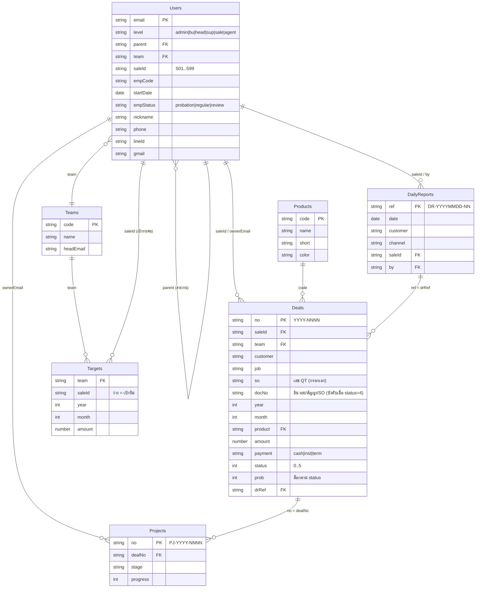

# Data Model — Prospect Intelligence AE workspace

> โครงสร้างข้อมูลหลังบ้าน (Google Sheets = ฐานข้อมูลกลาง) · สถานะ: v2 · อัปเดต 2026-11-24
>
> ไฟล์ implement: `apps-script/DataSchema.gs` (แท็บ + header + validation)
> เรียกสร้าง/อัปเดตครั้งแรก: รัน `setupDataSheets()` ใน editor หรือ `?api=1&action=setupSchema&token=<admin token>`

---

## 1) ภาพรวม



---

## 2) ตารางข้อมูล (Sheets Tabs)

### 2.1 `Users` (ผู้ใช้ + ข้อมูลพนักงาน)

| # | คอลัมน์ | ชนิด | บังคับ | ตัวอย่าง | หมายเหตุ |
|---|---|---|---|---|---|
| A | `email` | text | ✔ | `sale.test1@example.com` | **PK** (lowercase) |
| B | `name` | text | | `ทดสอบ AE 1` | ใช้จับคู่รายชื่อ AE |
| C | `level` | enum | ✔ | `sale` | `admin,bu,head,sup,sale,agent` |
| D | `status` | enum | ✔ | `active` | `active,disabled` |
| E | `passHash` | text | ✔ | `a1b2…` | SHA-256(pw + salt) |
| F | `salt` | text | ✔ | uuid | |
| G | `createdAt` | datetime | ✔ | `2026-11-24T03:10:00.000Z` | |
| H | `lastLogin` | datetime | | | อัปเดตตอน login |
| I | `parent` | text FK | | `aodpongtaptsr@gmail.com` | ผู้ดูแลสาย (ว่าง = L1) |
| J | `saleId` | text | | `S01` | ผูกกับ `Deals.saleId` |
| K | `team` | text FK | | `BU-SML` | |
| L | `empCode` | text | | `EMP-0001` | **text** (กันตัด 0) |
| M | `startDate` | date | | `2023-03-01` | ที่มาของ "อายุงาน" |
| N | `empStatus` | enum | | `regular` | `probation,regular,review` |
| O | `nickname` | text | | `ต๊ะ` | |
| P | `phone` | text | | `0812345678` | **text** |
| Q | `lineId` | text | | `tota.line` | |
| R | `gmail` | text | | `sale.test1@gmail.com` | อีเมลติดต่อ |
| S | `updatedAt` | datetime | ✔ | | ใช้ sync |
| T | `deleted` | 0/1 | | `0` | soft delete |

### 2.2 `Deals` (Pipeline / ดีล)

| # | คอลัมน์ | ชนิด | บังคับ | ตัวอย่าง | หมายเหตุ |
|---|---|---|---|---|---|
| A | `no` | text | ✔ | `2026-0001` | **PK** — รันต่อปี (server gen) |
| B | `ownerEmail` | text FK | ✔ | `sale.test1@example.com` | ผู้บันทึก |
| C | `saleId` | text FK | ✔ | `S01` | AE เจ้าของดีล |
| D | `team` | text FK | ✔ | `BU-SML` | denormalize เพื่อ query เร็ว |
| E | `customer` | text | ✔ | `บจก. ซักสบาย พลัส` | |
| F | `job` | text | ✔ | `ร้านสะดวกซัก 10 เครื่อง` | |
| G | `so` | text | | `QT-2026-0150` | เลข QT/อ้างอิง (กรอกเอง) |
| H | `docNo` | text | * | `INV-2026-0152` | **บังคับเมื่อ `status=4`** |
| I | `quoteDate` | date | ✔ | `2026-11-24` | |
| J | `year` | int | ✔ | `2026` | ปี ค.ศ. |
| K | `month` | int | ✔ | `11` | 1–12 (เดือนคาดปิด) |
| L | `product` | text FK | ✔ | `P4` | `Products.code` |
| M | `amount` | number | ✔ | `650000` | บาท |
| N | `payment` | enum | ✔ | `term` | `cash,inst,term` |
| O | `status` | int | ✔ | `4` | 0–5 (ดู §3) |
| P | `prob` | int | ✔ | `100` | ล็อกตาม `status` |
| Q | `drRef` | text FK | | `DR-20261123-01` | `DailyReports.ref` |
| R | `note` | text | | | |
| S | `createdAt` | datetime | ✔ | | |
| T | `updatedAt` | datetime | ✔ | | |
| U | `deleted` | 0/1 | | `0` | |

### 2.3 `DailyReports` (บันทึกเข้าพบลูกค้า)

| # | คอลัมน์ | ชนิด | ตัวอย่าง | หมายเหตุ |
|---|---|---|---|---|
| A | `ref` | text | `DR-20261123-01` | **PK** (วันที่ + ลำดับ) |
| B | `date` | date | `2026-11-23` | |
| C | `time` | text | `10:30` | |
| D | `customer` | text | `ครัวคุณแดง` | |
| E | `qt` | text | `QT-2026-0129` | เลขใบเสนอราคา (ถ้ามี) |
| F | `channel` | enum | `visit` | `visit,call,email,line,meeting` |
| G | `value` | number | `420000` | มูลค่าโครงการที่คุย |
| H | `summary` | text | | สรุปการคุย |
| I | `nextDate` | date | `2026-12-01` | นัดครั้งถัดไป |
| J | `nextTime` | text | `14:00` | |
| K | `nextNote` | text | | |
| L | `saleId` | text FK | `S01` | เจ้าของงาน |
| M | `by` | text FK | `sale.test1@example.com` | ผู้บันทึก |
| N | `createdAt` | datetime | | |
| O | `updatedAt` | datetime | | |
| P | `deleted` | 0/1 | `0` | |

### 2.4 `Targets` (เป้าหมาย — long format)

| # | คอลัมน์ | ชนิด | ตัวอย่าง | หมายเหตุ |
|---|---|---|---|---|
| A | `team` | text FK | `BU-SML` | |
| B | `saleId` | text | `S01` | **ว่าง = เป้าระดับทีม** |
| C | `year` | int | `2026` | |
| D | `month` | int | `11` | 1–12 (`0` = เป้าทั้งปี ถ้าต้องการ) |
| E | `amount` | number | `1500000` | |
| F | `updatedAt` | datetime | | |

> **PK ของตารางนี้ = `team + saleId + year + month`** (คีย์รวม)
> แนวคิด: เก็บเป็นรายเดือนทีละแถว → เพิ่ม "เป้ารายคน" ได้โดยไม่ต้องแก้โครงสร้าง

### 2.5 `Teams`

| # | คอลัมน์ | ชนิด | ตัวอย่าง |
|---|---|---|---|
| A | `code` | text | `BU-SML` |
| B | `name` | text | `BU-SML` |
| C | `headEmail` | text FK | `natthawut@…` |
| D | `active` | 0/1 | `1` |
| E | `updatedAt` | datetime | |

### 2.6 `Products`

| # | คอลัมน์ | ชนิด | ตัวอย่าง |
|---|---|---|---|
| A | `code` | text | `P4` |
| B | `name` | text | `เครื่องทำน้ำแข็ง` |
| C | `short` | text | `เครื่องน้ำแข็ง` |
| D | `color` | hex | `#0E9384` |
| E | `active` | 0/1 | `1` |
| F | `updatedAt` | datetime | |

ค่าเริ่มต้น: `P1` ร้านสะดวกซัก · `P2` ตู้กดน้ำ · `P3` ตู้กดน้ำ + เครื่องทำน้ำแข็ง · `P4` เครื่องทำน้ำแข็ง

### 2.7 `Projects` (Project Tracking)

| # | คอลัมน์ | ชนิด | หมายเหตุ |
|---|---|---|---|
| A | `no` | text | `PJ-2026-0001` |
| B | `customer` | text | |
| C | `job` | text | |
| D | `dealNo` | text FK | `Deals.no` |
| E | `stage` | text | Planning → Completed |
| F | `ownerEmail` | text FK | |
| G | `startDate` | date | |
| H | `dueDate` | date | |
| I | `deliveredDate` | date | |
| J | `progress` | int | 0–100 |
| K | `blocker` | text | |
| L | `createdAt` / M `updatedAt` / N `deleted` | | |

### 2.8 `Logs` (audit trail)

| # | คอลัมน์ | ตัวอย่าง |
|---|---|---|
| A | `ts` | `2026-11-24T06:30:12.000Z` |
| B | `action` | `deal.add` |
| C | `ref` | `2026-0001 · บจก. …` |
| D | `detail` | `ร้านสะดวกซัก 10 เครื่อง · ฿650,000 · Actual` |
| E | `by` | `sale.test1@example.com` |

---

## 3) สถานะงาน ↔ โอกาสปิด ↔ สูตรคำนวณ

| status | ชื่อ | prob (%) | นับใน Forecast |
|---|---|---|---|
| 0 | กำลังคุย Detail | 25 | – |
| 1 | Pipeline | 50 | **25%** ของยอด |
| 2 | รอยืนยัน PO | 75 | **50%** ของยอด |
| 3 | รอส่งของ / เปิดบิลอินวอย | 90 | **100%** ของยอด |
| 4 | Actual (ปิดงานแล้ว) | 100 | **100%** ของยอด |
| 5 | ยกเลิก | 0 | – |

```
sum43    = Actual + รอส่งของ
sum432   = Actual + รอส่งของ + รอยืนยัน PO
forecast = (Actual + รอส่งของ) × 1.0 + PO × 0.5 + Pipeline × 0.25
```

> `prob` เป็นค่าที่ระบบใส่ให้อัตโนมัติ (ห้ามแก้มือ) — ใช้แสดงผล/คำนวณ风险评估เท่านั้น
> น้ำหนัก Forecast เก็บเป็นค่าคงที่ในโค้ด ไม่เก็บใน Sheet

---

## 4) กติกา ID

| ข้อมูล | รูปแบบ | ใครสร้าง | หมายเหตุ |
|---|---|---|---|
| เลขดีล | `YYYY-NNNN` | ระบบ (server / client สำรอง) | รันต่อปี, ไม่ซ้ำ |
| เลข QT | อิสระ (ผู้ใช้กรอก) | มนุษย์ | เช่น `QT-2026-0150` |
| เลขอินวอย/สัญญา/SO | อิสระ | มนุษย์ | บังคับเมื่อปิดงาน |
| Daily ref | `DR-YYYYMMDD-NN` | ระบบ | NN = ลำดับของวัน |
| โครงการ | `PJ-YYYY-NNNN` | ระบบ | |
| AE | `S01…S99` | ระบบ | ผูกกับ `Users.saleId` |

---

## 5) ปริมาณข้อมูล & แผนรองรับ

ประมาณการ: AE 10 คน × 25 ดีล/เดือน ≈ 3,000 ดีล/ปี · Daily 10 × 40/เดือน ≈ 4,800 แถว/ปี

| เกณฑ์ | แนวปฏิบัติ |
|---|---|
| 1 แท็บ ≤ 20,000 แถว | เกิน → archive แยกปี `Deals_2026`, `DailyReports_2026` แล้วลบจากแท็บหลัก |
| อ่านข้อมูล | ใช้ `QUERY/FILTER` ในชีตสรุป หรือ API กรองตาม `team` + `year/month` |
| เขียนข้อมูล | ต่อท้าย (append) เท่านั้น — ห้าม `insertRow` กลางตารางบ่อย ๆ |
| ดัชนี | เรียง `Deals` จากใหม่ → เก่า (`no` desc) เพื่อให้ค้นหาล่าสุดไว |
| Cache | ฝั่งเว็บเก็บ localStorage แล้ว sync ส่วนต่างด้วย `updatedAt` |
| Backup | ตั้ง trigger สำรองไฟล์ทุกวัน 02:00 (`DriveApp.makeCopy`) เก็บ 30 วัน |

---

## 6) Sync ฝั่งเว็บ (localStorage → Sheet)

สถานะปัจจุบัน: ข้อมูลดีล/เป้าหมาย/สินค้า เก็บใน `localStorage` ของแต่ละเครื่อง
แผนย้ายขึ้น Sheet (ทำทีละก้าว):

1. **อ่าน**: `GET ?action=deals&token=…` → เขียนทับ cache `pi_sr_deals_v2`
2. **เขียน**: `POST ?action=saveDeal` (upsert ตาม `no`) → คืนชุดข้อมูลล่าสุด
3. **ชนกัน**: เทียบ `updatedAt` — ใหม่กว่าชนะ (last-write-wins) + เก็บ `Logs`
4. **ลบ**: `deleted=1` แล้วซ่อนจาก API
5. **ออฟไลน์**: เขียน localStorage ก่อน, ตั้ง `_dirty=1`, ค่อย push เมื่อออนไลน์

คีย์ localStorage ที่ต้อง map:

| localStorage | ตาราง |
|---|---|
| `pi_sr_deals_v2` | `Deals` |
| `pi_sr_sales_v1` | `Users` (เฉพาะ level sale/agent) |
| `pi_sr_targets_v2` | `Targets` |
| `pi_sr_products_v1` | `Products` |
| `pi_sr_teams_v1` | `Teams` |
| `pi_daily_v1` | `DailyReports` |
| `pi_log_v1` | `Logs` |
| `pi_projects_v2` | `Projects` |

---

## 7) Migration: Deals เดิม (v1) → v2

แท็บ `Deals` เดิมมี 13 คอลัมน์ (`id, ownerEmail, ownerName, name, customer, value, stage, probability, close, nextAction, status, createdAt, updatedAt`)

`setupDataSheets()` จะ **เติมคอลัมน์ที่ขาดต่อท้าย** (ไม่ทับข้อมูลเดิม) แล้วจึงแปลงค่า:

| ค่าเดิม | แปลงเป็น |
|---|---|
| `id` (`D-1729…`) | คงไว้ใน `note` ชั่วคราว / ตั้ง `no` ใหม่ตามปี |
| `name` | `job` |
| `value` | `amount` |
| `stage` (Prospect…Won) | `status` (0…4) ด้วยตาราง map |
| `probability` | `prob` ตาม `status` |
| `close` (`YYYY-MM-DD`) | `year` + `month` |
| `status` (Healthy…) | ทิ้ง (ใช้ `status` ตัวเลขแทน) |

> หมายเหตุ: ชีต `Deals` เดิมไม่ถูกใช้โดยหน้าเว็บหลัก (หน้าเว็บใช้ localStorage) — การ migrate ทำเมื่อพร้อมย้ายขึ้น cloud
